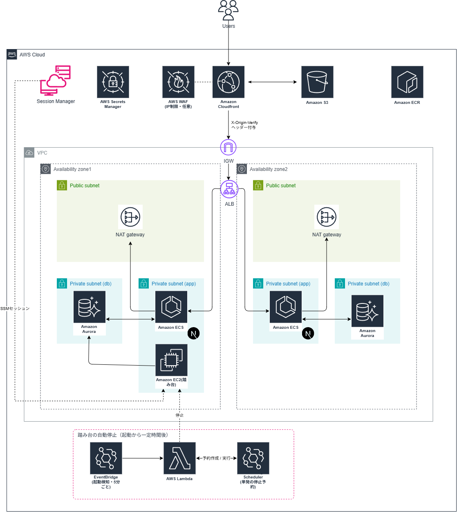

# nextjs-ssr

## 概要
nextjs(SSR)をAWSにデプロイするterraformのコード
画像などはS3に配置しcloudFront経由で取得を行う想定
SSRページは編集の即時反映を優先して毎回レンダリングする（キャッシュしない）
CloudFrontでキャッシュするのは静的シェル・画像・アセットで、アプリが `Cache-Control`（`revalidate`）を返せばSSRページのキャッシュにも切り替えられる

- app
   - nextjsのコードを配置
- infra
   - terraformのコードを配置

## ディレクトリ構成

```
infra/
├── env/                  # 環境ごとのルートモジュール（ここで terraform を実行する）
│   ├── dev/
│   ├── stg/
│   └── prd/
└── modules/              # 環境から呼び出される部品
    ├── network/          # VPC / subnet / IGW / NAT / route
    ├── app/              # ALB / ECS / Aurora / ECR / S3 / Secrets Manager
    └── edge/             # CloudFront / 閲覧者IP制限用WAF
```
## デプロイ手順

初回デプロイのチェックリスト、ECRへのpush、Terraformの適用順序、DB migration、動作確認は [DEPLOY.md](DEPLOY.md) を参照する。

## CloudFrontの閲覧者IP制限

各環境の `infra/env/<環境>/terraform.tfvars` で、IPv4・IPv6の許可CIDRをそれぞれ複数指定できる。

```hcl
cloudfront_ip_restriction_enabled = true
cloudfront_allowed_ipv4_cidrs = [
  "203.0.113.10/32",
  "198.51.100.0/24",
]
cloudfront_allowed_ipv6_cidrs = [
  "2001:db8::10/128",
  "2001:db8:1234::/48",
]
```

## DBへの接続（踏み台経由）

Auroraはインターネット経路のないDBサブネットにあるため、踏み台EC2を経由した
SSMポートフォワーディングで接続する。踏み台はインバウンド全閉・公開IPなし・SSHキーなしで、
接続はSSM Session Manager（IAM認証）のみ。

### 前提

- AWS CLI + [Session Manager plugin](https://docs.aws.amazon.com/systems-manager/latest/userguide/session-manager-working-with-install-plugin.html) をローカルにインストール
- 実行するIAMユーザー/ロールに `ssm:StartSession` の許可（対象を踏み台に限定する例）

```json
{
  "Effect": "Allow",
  "Action": "ssm:StartSession",
  "Resource": [
    "arn:aws:ec2:ap-northeast-1:<ACCOUNT_ID>:instance/<踏み台のインスタンスID>",
    "arn:aws:ssm:*:*:document/AWS-StartPortForwardingSessionToRemoteHost"
  ]
}
```

### 接続手順

Linux（bash）では次のコマンドでトンネルを張る（プロジェクトルートで実行）。

```bash
cd infra/env/dev

# トンネルを張る（ローカルの15432 → Auroraの5432）
aws ssm start-session \
  --target $(terraform output -raw bastion_instance_id) \
  --document-name AWS-StartPortForwardingSessionToRemoteHost \
  --parameters "{\"host\":[\"$(terraform output -raw aurora_writer_endpoint)\"],\"portNumber\":[\"5432\"],\"localPortNumber\":[\"15432\"]}"
```

接続情報はSecrets Managerに保存されている。トンネルを開いたまま、別のLinux（bash）ターミナルでプロジェクトルートから接続を確認する。

```bash
mkdir -p app/certs
curl --fail --location https://truststore.pki.rds.amazonaws.com/global/global-bundle.pem -o app/certs/global-bundle.pem
AURORA_WRITER=$(terraform -chdir=infra/env/dev output -raw aurora_writer_endpoint)
psql "host=$AURORA_WRITER hostaddr=127.0.0.1 port=15432 user=postgres dbname=app sslmode=verify-full sslrootcert=app/certs/global-bundle.pem"
```

### DB接続のTLS設定

ローカルのWeb開発はHTTPのまま、ローカルPostgreSQLは `DB_SSL_MODE=disable`（未指定時も同じ）で利用する。
`app/.env.example` を `app/.env.local` にコピーすると、composeのDBポート5433に接続できる。

Auroraは `DB_SSL_MODE=verify-full` を指定し、AWSのCA証明書と接続先名を検証する。
ECSタスク定義はTLSを有効にし、Dockerfileがビルド時に取得した `/app/certs/global-bundle.pem` を利用する。
writer / readerはそれぞれのエンドポイント名を検証する。ブラウザのHTTP/HTTPS設定とは独立している。

参考: [AuroraのCA証明書](https://docs.aws.amazon.com/AmazonRDS/latest/AuroraUserGuide/UsingWithRDS.SSL.html)

### 踏み台の停止・起動

使わないときは停止しておく（EC2の課金を止める。SSM接続は起動中のみ可能）。

```
aws ec2 stop-instances --instance-ids $(terraform output -raw bastion_instance_id)
aws ec2 start-instances --instance-ids $(terraform output -raw bastion_instance_id)
```

## 削除方法

```
cd infra/env/dev
terraform destroy
```

## 構成図


